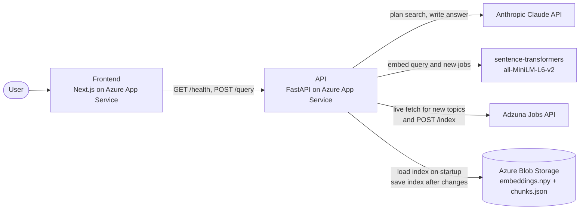
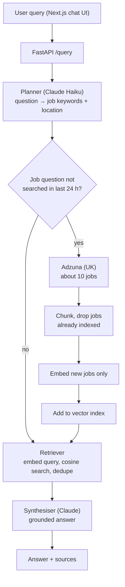
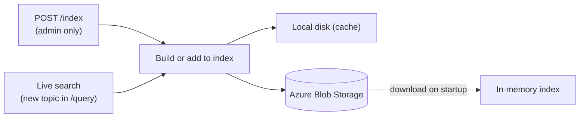
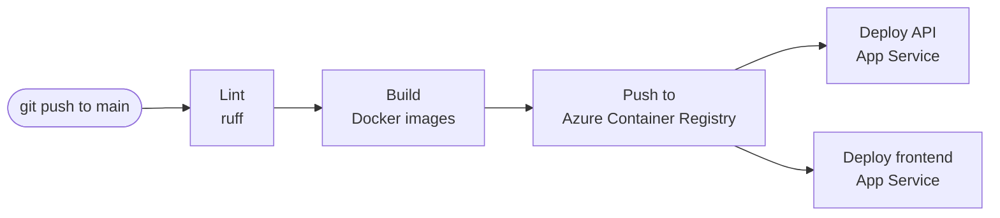

# JobSense 🧠

> Real-time job market intelligence powered by a custom RAG pipeline and Claude AI.

JobSense answers questions about the UK job market using live listings. JobSense searches live job listings and uses Claude to generate grounded, honest career insights. Every answer is backed by real job data fetched from the Adzuna API.

> **⚠️ The live Azure deployment has been taken down.** It ran on an Azure free-trial account that has now expired, so the old `azurewebsites.net` links no longer work. **Watch the demo video below to see the app in action.** A new hosted version will be linked here once it's available.

---

## Demo

[](https://youtu.be/ke1LDtCpW8I)

▶️ **[Watch the demo on YouTube](https://youtu.be/ke1LDtCpW8I)**

The video shows the chat answering a question from the live index, fetching fresh listings for a new topic ("Searching live listings…"), the answer streaming in word by word, and the sources behind each answer.

You can also run it yourself in a few minutes. See [Quickstart](#quickstart).

---

## What it does

Ask JobSense anything about the UK job market:

- *"What data engineering roles are hiring in London right now?"*
- *"I know Python and Spark — what jobs suit me?"*
- *"Any warehouse jobs in Manchester?"*
- *"What salary should I expect as an MLOps engineer?"*

A small planner model turns your question into a job search (keywords and an optional location). If that topic hasn't been searched in the last 24 hours, JobSense fetches live listings, embeds only the new ones and adds them to the index. It then finds the most relevant listings with semantic search and hands them to Claude to generate a grounded answer with sources.

---

## Architecture

### Cloud architecture



### Query flow



Every failure on the live path (planner, Adzuna, embedding) falls back to the existing index, so a query never fails because live search did.

### How the index is built and persisted



The App Service disk is wiped on every restart, so Blob Storage is the permanent copy of the index. On startup the API downloads it into memory, and `/query` works immediately with no re-indexing. Without a connection string (for example in local development) it falls back to local disk only.

---

## Stack

| Layer | Technology |
|---|---|
| Frontend | Next.js 16, React 19, Tailwind CSS, TypeScript |
| API | FastAPI |
| LLM | Claude claude-sonnet-4-6 for answers, Claude Haiku for search planning (Anthropic) |
| Embeddings | sentence-transformers / all-MiniLM-L6-v2 |
| Vector store | NumPy (custom, no external DB) |
| Index persistence | Azure Blob Storage |
| Data source | Adzuna Jobs API (UK) |
| MLOps | MLflow |
| Containerisation | Docker, Docker Compose |
| CI/CD | GitHub Actions |
| Cloud | Azure App Service, Azure Container Registry, Azure Blob Storage |
| CLI | Python argparse |

Built without LangChain or LlamaIndex — every RAG component written from scratch.

### Azure services

| Service | Purpose |
|---|---|
| App Service (×2) | Hosts the API and frontend containers |
| Container Registry | Stores the Docker images |
| Blob Storage | Persists the vector index across restarts |

---

## Live search

The index isn't limited to a fixed set of roles. It grows as people ask questions.

| Setting | Value |
|---|---|
| Jobs fetched per new topic | 10 |
| Freshness window | 24 hours (the same topic isn't fetched again within it) |
| Live search cap | 10 per hour, 40 per day |
| Region | UK only |

- **Planner.** One small Claude call converts the question into keywords and an optional location. "I know Python and Spark" becomes a job title like "data engineer", and a greeting is recognised as not being a job question, so nothing is fetched.
- **Deduplication.** Jobs are matched by ID, so overlapping searches never embed the same listing twice.
- **Rate limits.** The caps keep usage inside Adzuna's free-key limits. They live in memory and reset when the app restarts.
- **Empty results.** If a search returns nothing, it isn't remembered, so it is retried later within the caps.
- **Response.** `/query` returns a `live_search` field describing what happened (`fetched`, `recently_searched`, `not_a_job_search`, `rate_limited`, `no_listings` or `error`).

---

## Design decisions

- **Live search with a planner.** Adzuna is a keyword search, so a conversational question returns poor results. A small model first converts the question into a job title and location, and a freshness window avoids repeat calls for the same topic.
- **Blob Storage for the index.** App Service containers have an ephemeral disk, so an index built on the server would vanish on every restart. The index is stored in Blob and downloaded on startup. Both files are downloaded to temporary names and swapped in together, so a failed download can never leave a mismatched pair.
- **Safe concurrent updates.** Live searches run one at a time behind a lock, and the in-memory matrix and metadata are swapped in together, so a query never reads a half-updated index.
- **Flat NumPy index instead of a vector database.** At this dataset size (hundreds to a few thousand chunks), a single matrix multiply is fast enough, and there is no extra service to run or pay for.
- **Streamed answers.** `/query/stream` sends the answer as Server-Sent Events (`status`, `sources`, `token`, `done`), so the first words appear in about a second instead of after the full 3 to 8 second Claude call. While a new topic is being fetched, the chat shows "Searching live listings…". The frontend falls back to the plain `/query` endpoint if streaming isn't available.
- **Cold-start handling in the UI.** On the free tier the backend sleeps when idle. The frontend polls `/health` on load, shows a waking-up banner, and only enables the chat once the API is ready.
- **Model baked into the Docker image.** The embedding model is downloaded at build time, so a cold start doesn't need to fetch it from Hugging Face.
- **Blocking endpoints run in a thread pool.** `/query` and `/index` are plain `def` endpoints, so a long Claude call or index build doesn't block `/health`.
- **MLflow is best-effort.** A failed experiment-tracking write is logged and never loses an answer or breaks an index build.
- **Admin-only indexing.** `POST /index` requires an `X-API-Key` header, so strangers can't rebuild the index or use up the Adzuna quota.

---

## Project Structure

```
jobsense/
├── src/
│   ├── ingestion/
│   │   └── job_fetcher.py      # Adzuna API client
│   ├── pipeline/
│   │   ├── chunker.py          # splits job descriptions into chunks
│   │   ├── embedder.py         # sentence-transformers encoder + MLflow
│   │   └── vector_store.py     # numpy index — build / load / search + Azure Blob persistence
│   └── rag/
│       ├── search_planner.py   # question → job keywords + location (Claude Haiku)
│       ├── live_search.py      # fetch → dedupe → embed → add, with caps and freshness
│       ├── streaming.py        # builds the Server-Sent Events stream for /query/stream
│       ├── retriever.py        # embed query → search → deduplicate
│       └── synthesiser.py      # context + Claude → grounded answer
├── api/
│   └── main.py                 # FastAPI — /health /index /query
├── frontend/                   # Next.js chatbot UI
│   ├── Dockerfile
│   └── app/
│       ├── page.tsx            # chatbot interface + server wake-up check
│       └── layout.tsx          # app shell
├── .github/
│   └── workflows/
│       └── ci.yml              # GitHub Actions CI/CD pipeline
├── Dockerfile                  # API container
├── docker-compose.yml          # run full stack locally
├── pipeline.py                 # CLI entry point
├── config.yaml                 # chunk size, model, location, top_k, blob settings
└── pyproject.toml
```

---

## Quickstart

### 1. Clone and install

```bash
git clone https://github.com/<your-username>/jobsense.git
cd jobsense
python -m venv .venv
source .venv/bin/activate
pip install -e .
pip install -r requirements.txt
```

### 2. Add credentials

Create a `.env` file in the project root:

```
ANTHROPIC_API_KEY=sk-ant-...
ADZUNA_APP_ID=your_app_id
ADZUNA_API_KEY=your_api_key
MLFLOW_TRACKING_URI=sqlite:///mlflow.db
INDEX_ADMIN_KEY=choose-a-long-random-string
```

- Anthropic API key → [console.anthropic.com](https://console.anthropic.com)
- Adzuna credentials → [developer.adzuna.com](https://developer.adzuna.com) (free)
- `MLFLOW_TRACKING_URI` uses a SQLite database, because recent MLflow versions no longer support the old `./mlruns` folder backend.
- `INDEX_ADMIN_KEY` is only needed if you call `POST /index`. Without it, that endpoint stays disabled.

Optional: add `AZURE_STORAGE_CONNECTION_STRING=...` to also persist the index to Azure Blob locally. Without it the index is stored on local disk only.

### 3. Build the index (optional)

You can start with an empty index, because live search fills it as you ask questions. To pre-load some listings instead:

```bash
# Fetch live jobs and build the vector index
python pipeline.py index

# Custom queries
python pipeline.py index \
  --queries "PySpark engineer" "MLOps engineer" "LLM engineer" \
  --max-per-query 20

# Re-index without hitting Adzuna again
python pipeline.py index --no-fetch
```

### 4. Start the API

```bash
uvicorn api.main:app --port 8000
```

### 5. Start the frontend

```bash
cd frontend
npm install
npm run dev
```

Open **http://localhost:3000** — the chatbot is ready.

---

## Run with Docker

```bash
# Run the full stack with one command
docker-compose up --build

# API → http://localhost:8000
# UI  → http://localhost:3000
```

---

## CI/CD Pipeline



Every push to `main` triggers a GitHub Actions pipeline:

```
lint    → ruff checks Python code quality
build   → builds both Docker images
deploy  → pushes to Azure Container Registry
        → deploys to Azure App Service
```

Pull requests run lint and build only; deployment happens on pushes to `main`.

---

## Deploying to Azure

1. Create two App Services (API and frontend) and a Container Registry, and add the credentials as GitHub secrets (see `ci.yml` for the names used).
2. Create a Storage Account and add these as application settings on the API App Service:

   | Setting | Purpose |
   |---|---|
   | `ANTHROPIC_API_KEY` | Claude API access (answers and search planning) |
   | `ADZUNA_APP_ID` | Adzuna API access |
   | `ADZUNA_API_KEY` | Adzuna API access |
   | `AZURE_STORAGE_CONNECTION_STRING` | Persists the index to Blob Storage |
   | `INDEX_ADMIN_KEY` | Secret required to call `POST /index` |

3. Push to `main` to deploy.
4. Optionally seed the index. This is admin-only, so send the key you set as `INDEX_ADMIN_KEY`:

   ```bash
   curl -X POST https://<your-api>.azurewebsites.net/index \
        -H "X-API-Key: <your INDEX_ADMIN_KEY>" \
        -H "Content-Type: application/json" \
        -d '{"queries": ["data engineer", "ML engineer"], "max_per_query": 10}'
   ```

   The response includes `"persisted_to_blob": true` when the index has been saved to Blob. Note that `/index` replaces the whole index, including listings added by live search. Live search will simply fetch them again when asked.

---

## CLI Usage

```bash
python pipeline.py query "Python data engineer with Spark experience"
python pipeline.py query "entry level ML engineer London" --top-k 3
```

---

## API

Interactive docs at **http://localhost:8000/docs**

| Method | Endpoint | Description |
|---|---|---|
| GET | `/health` | Liveness check, index status and index source (`blob` / `disk` / `built`) |
| POST | `/index` | Admin only (`X-API-Key`). Fetch jobs, rebuild the whole vector index and save it to Blob |
| POST | `/query` | RAG query. Fetches live listings for new topics, then returns the answer and sources |
| POST | `/query/stream` | Same pipeline, streamed as Server-Sent Events so the answer appears word by word |
| GET | `/index/stats` | Detailed index statistics |

### Example

```bash
curl -X POST http://localhost:8000/query \
     -H "Content-Type: application/json" \
     -d '{"query": "Any warehouse jobs in Manchester?"}'
```

### Response

```json
{
  "answer": "Based on the current listings, two roles stand out...",
  "query": "Any warehouse jobs in Manchester?",
  "model": "claude-sonnet-4-6",
  "input_tokens": 1198,
  "output_tokens": 312,
  "latency_secs": 8.95,
  "sources": [
    {
      "rank": 1,
      "title": "Warehouse Operative",
      "company": "Example Logistics",
      "location": "Manchester",
      "salary": "£24,000 – £27,000",
      "score": 0.8821,
      "url": "https://..."
    }
  ],
  "live_search": {
    "searched": true,
    "keywords": "warehouse operative",
    "location": "Manchester",
    "new_jobs": 8,
    "reason": "fetched"
  }
}
```

---

## MLflow Tracking

Every pipeline run is tracked automatically:

```bash
mlflow ui --backend-store-uri sqlite:///mlflow.db
# Open http://localhost:5000
```

Tracked experiments:
- `jobsense-embeddings` — encode time, chunks/sec, model name
- `jobsense-index` — index size, build time
- `jobsense-synthesis` — token usage, latency, chunks used

---

## Configuration

Edit `config.yaml` to tune the pipeline:

```yaml
ingestion:
  max_jobs: 500
  location: "London, UK"

pipeline:
  chunk_size: 256          # tokens per chunk
  chunk_overlap: 40        # token overlap between chunks
  embedding_model: "all-MiniLM-L6-v2"
  top_k: 5                 # chunks to retrieve per query

blob:
  container: "jobsense-index"   # Azure Blob container (created on first upload)
  prefix: "current/"            # blob name prefix for the index files
```

The live-search limits (jobs per search, freshness window and caps) are constants at the top of `src/rag/live_search.py`.

---

## Data source

Job listings are provided by [Adzuna](https://www.adzuna.co.uk). **Jobs by Adzuna.**